# TransitOS User Manual

**Transport Operations · Unified**

Version 1.1 · General user manual and role-based manuals for every role in the TransitOS platform.

Read Part 1 once, then the section in Part 2 that matches your role. Every screenshot in this manual is a real capture of the shipped application running against live data.

---

## Part 0 — About this manual

### 0.1 Who this manual is for

This manual is written for the people who use TransitOS every day: dispatchers, branch managers, fleet managers, accountants, drivers and conductors, and the managers who supervise them.

It has two halves:

- **Part 1 — the general manual.** Signing in, the dashboard, navigation, your profile, notifications and the everyday things you do in the app. Read this once; it applies to everybody.
- **Part 2 — the role manuals.** One section per role, describing exactly what that role can reach and how to do the work that belongs to it. Read the section for your own role, and skim the one above you if you need to know what your manager sees.

### 0.2 How the manual is organised

Every screenshot in this manual is a **real capture of the shipped app**, taken against a live database containing realistic data. Nothing is drawn by hand. When a screen in the app differs from the picture here, the app is right and the manual is out of date.

| Part | Contents | Who reads it |
|---|---|---|
| Part 1 | General manual | Everyone |
| Part 2 | Role manuals | The role that owns the section |
| Part 3 | Reference tables and troubleshooting | When you need a lookup |

### 0.3 Reading the screenshots

Screenshots show the app on a phone. Where a screen has a coloured badge or chip, its colour carries meaning — Part 3.1 lists every colour used.

### 0.4 Getting help

If something in the app does not behave as this manual describes, contact your branch manager or the platform administrator. For access problems (a locked account, a forgotten password), see Part 1.1.

---

## Part 1 — General user manual

### 1.1 Signing in

The TransitOS app opens on the sign-in screen.

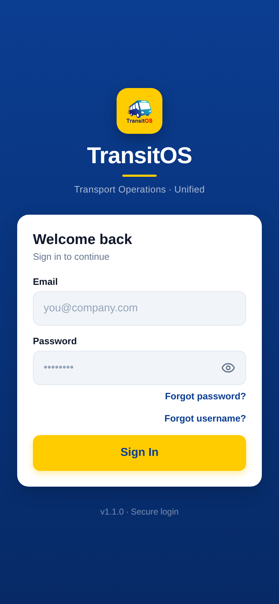

*The TransitOS sign-in screen*

Enter the **email address** your administrator gave you and your **password**, then tap **Sign In**.

> **First time?** Your administrator creates your account and tells you the address and a temporary password. Change it from **Profile** after your first sign-in — see Part 1.4.

#### If you have forgotten your password

*Reset your password*

Tap **Forgot password?**, enter your email address and the app sends a reset link. The link opens your browser, where you set a new password.

#### If you have forgotten your username

*Recover your username*

Tap **Forgot username?**, enter your email address and the app emails you the address you sign in with.

#### Signing out

Open **Profile** and tap **Sign Out**. You will need to sign in again to reach your data. Always sign out on a shared device — for example a depot terminal used by more than one person.

#### Your session

TransitOS keeps you signed in between sessions so you do not have to sign in on every trip. If your session expires while you are using the app, it signs you back in automatically with a refreshed token. If it cannot, you are returned to the sign-in screen and nothing you were editing is lost.

---

### 1.2 Your dashboard

The dashboard is the first screen after sign-in. The navy header greets you by name and shows your role; below it are the figures that matter for your job.

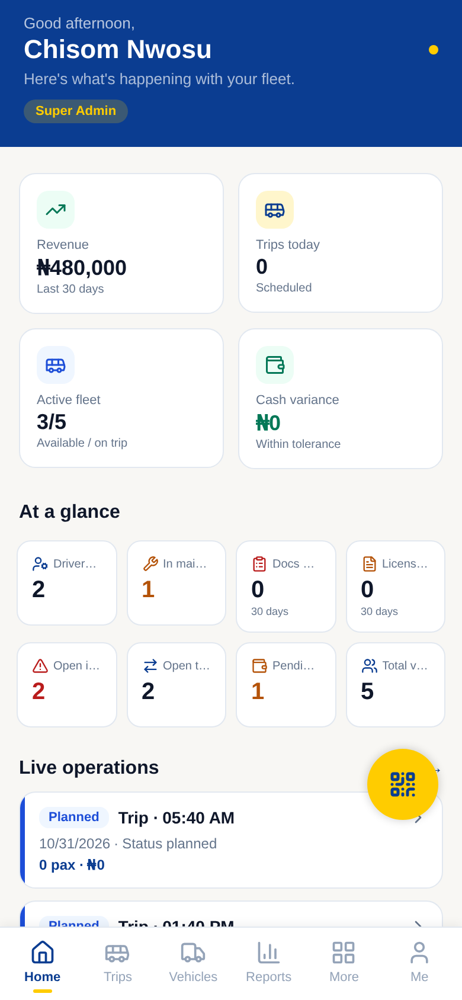

*The dashboard*

| Tile | What it tells you |
|---|---|
| Revenue | Money taken across the trips in scope. |
| Active buses | How many vehicles are on a trip against the total fleet. |
| Cash variance | Whether the money declared on cash-ups matches what the trips expected. |
| Open incidents | Problems still awaiting a response. |

The greeting changes with the time of day. Pull the screen down to refresh the figures — useful after you or someone else has just recorded something. Each role sees the tiles that apply to it, so your dashboard may differ from the one pictured here.

---

### 1.3 Getting around

#### The tab bar

The bar along the bottom is your main navigation. Which tabs appear depends on your role.

| Tab | What is on it |
|---|---|
| **Home** | The dashboard. |
| **Trips** | The trip list and live board. |
| **Vehicles** | The fleet. |
| **Reports** | Financial and operational reporting. |
| **More** | Everything else, grouped by area. |
| **Profile** | Your details and security settings. |

#### The More menu

*The More menu*

The More menu is grouped into **Operations**, **Finance**, **Fleet** and **System**. Tiles your role cannot use are not shown — if you cannot see a tile, you do not have that responsibility. Your branch scope is stated under your name: *Branch scoped* means you see only your own branch, *All branches* means you see the whole company.

#### Which tabs your role gets

| Role | Tabs |
|---|---|
| Super Admin | Home, Trips, Vehicles, More, Reports, Profile |
| Owner | Home, Trips, Vehicles, More, Reports, Profile |
| General Manager | Home, Trips, Vehicles, More, Reports, Profile |
| Branch Manager | Home, Trips, Vehicles, More, Reports, Profile |
| Operations Manager | Home, Trips, Vehicles, More, Reports, Profile |
| Fleet Manager | Home, Trips, Vehicles, More, Reports, Profile |
| Chief Accountant | Home, More, Reports, Profile |
| Branch Accountant | Home, Trips, More, Reports, Profile |
| Driver | Home, Trips, More, Profile |
| Conductor | Home, Trips, More, Profile |

---

### 1.4 Your profile and security

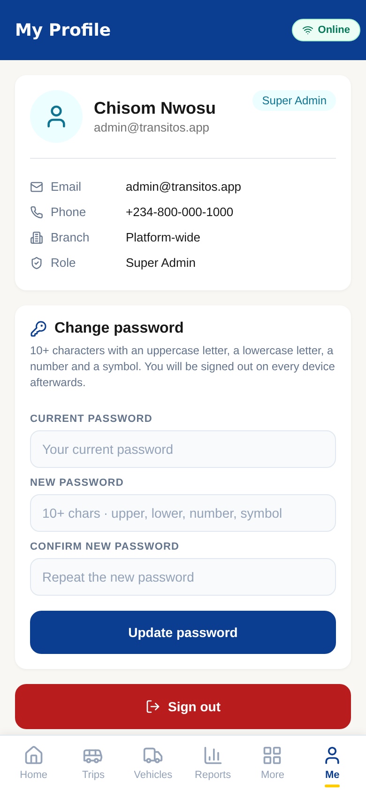

*Your profile*

From **Profile** you can review your own details, change your password and review the devices signed in to your account.

#### Changing your password

Tap **Change password** and enter your current password and your new one. The new password must meet the company's rules: at least 8 characters, with an upper-case letter, a lower-case letter, a digit and a special character. The app tells you which rule you have not met rather than just refusing the change.

#### Your devices

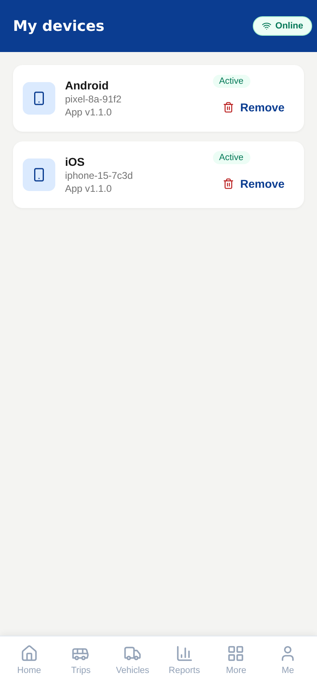

*Registered devices*

Every phone that registers for push notifications appears here with its platform and the app version. If you sell your phone or replace it, tap **Unregister** on the old one — otherwise it keeps receiving alerts that nobody reads.

---

### 1.5 Notifications

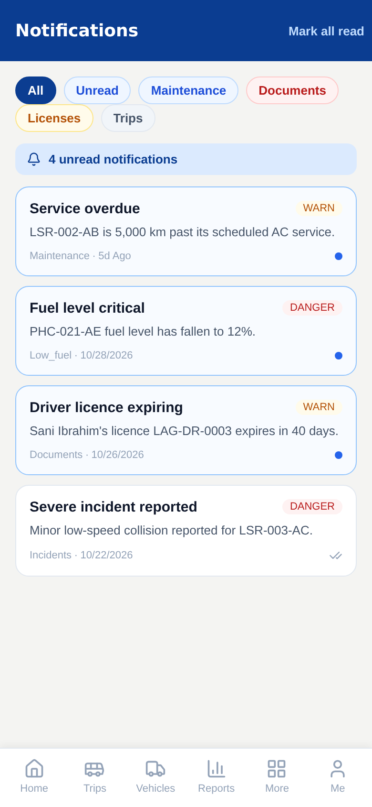

*The notification inbox*

The inbox collects what the system raises automatically: a licence about to expire, servicing that has fallen due, a vehicle low on fuel, a severe incident, a cash-up awaiting approval. Unread items are highlighted; opening one marks it read.

You are only notified about things that affect you. A crew member sees their own trips; a fleet manager sees servicing and fuel; finance sees cash-ups and settlements.

---

### 1.6 The interface at a glance

TransitOS uses one consistent visual language, so once you know it you can read any screen.

| Element | What it means |
|---|---|
| **Card** | A white panel holding one record or one group of facts. |
| **Badge / Chip** | A small coloured label carrying a status. The colour is meaningful — see Part 3.1. |
| **Button (yellow)** | The primary action on a screen. There is usually only one. |
| **Button (outline / ghost)** | A secondary action. |
| **Button (danger)** | A destructive action, such as deleting. |
| **Field** | A labelled box you type into. A line under the label tells you what to enter; an error appears beneath the box. |
| **Select** | A dropdown. Tap it, then tap the option you want. |
| **Modal** | A panel that opens over the screen for a short task. Tap outside it to dismiss it without saving. |
| **Empty state** | The message shown when there is nothing to list yet, with the button that creates the first one. |
| **Spinner** | Work in progress. |
| **Online / Offline badge** | Whether the app can currently reach the server. |

---

### 1.7 Everyday tasks

#### Finding something

Long lists have a filter row across the top. Tap a filter to narrow the list — status, branch, vehicle or date. Most lists page: scroll to the bottom to load the next page.

#### Adding a record

Tap the yellow button on the screen — **Add vehicle**, **Record expense**, **New trip**, and so on. Fill in the form and save. Required fields are marked; the app will not let you save an incomplete record, and it tells you which field is the problem rather than failing silently.

#### Editing a record

Open the record from its list and tap its edit control. The control is named for what it changes: **Edit details** on a vehicle, **Edit** on an expense, a fuel log or a maintenance record, and **Edit pay rates** on a settlement.

Two records are changed where they live rather than on their own screen. A **cash-up** is corrected on the trip it belongs to — **Save cash-up** — and an **incident** is closed with **Acknowledge** or **Resolve incident**.

A **trip** cannot be edited. Its route, vehicle, crew and schedule are set when it is created; to change one, cancel the trip and create another.

#### Deleting a record

Open the record, tap **Delete**, and confirm. **Delete** is not everywhere: it appears on vehicles, users, expenses, fuel logs and maintenance records. A trip, a cash-up, an incident and a settlement are not deleted from the app — a trip is cancelled, and a settlement is settled or disputed.

Deleting is a soft delete: the record leaves the list but its data is kept server-side for audit and reporting. Nothing in the app brings it back, so if you delete something by mistake, tell an administrator rather than re-creating it.

#### Exporting a report

Open **Reports**, choose a period — 7, 30 or 90 days — and tap the export button. TransitOS produces a PDF you can save, email or print.

---

## Part 2 — Role manuals

Each section below describes one role: who it is for, what it can reach, how the daily work is done, and where its authority stops.

Use **Part 3.2** for the full screen-by-role access table.

### 2.1 Platform Administrator

*Role code: `super_admin`*

**Who this role is for.** The person who owns the TransitOS platform itself: accounts, branches, role permissions and the audit trail. Usually one or two people, and often outside the operating company.

**What you are responsible for**

- Every user account in the system, across every branch
- Branch creation and branch configuration
- The role-permission matrix — what each role may do
- The audit log of every recorded action
- Fleet, route, trip and incident records company-wide

**What you can reach**

Tab bar: Home, Trips, Vehicles, More, Reports, Profile.

Screens: `/branches`, `/users`, `/vehicles`, `/drivers`, `/conductors`, `/routes`, `/trips`, `/fuel`, `/maintenance`, `/expenses`, `/cash-ups`, `/reports`, `/audit-log`, `/role-permissions`, `/map`, `/transfers`, `/incidents`, `/pre-trip-checklist`, `/settlements`, `/devices`, `/trips/live`, `/scan`.

#### The audit log

The audit log is your record of everything that has happened. Filter by actor to see one person's activity, or by action type to see every change, deletion or sign-in. Use it to answer a question like *who changed this vehicle's status?* without guessing.

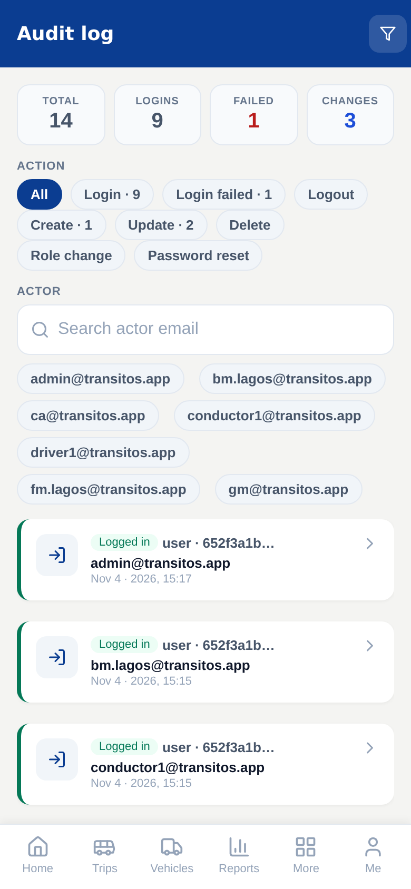

*The audit log*

#### Role permissions

This screen defines what each role may do. Select a role to review its permissions, change them and save. The change applies from the next sign-in, so ask the affected person to sign out and back in. Resetting **every** role to its defaults is offered only to the Super Admin and the Owner.

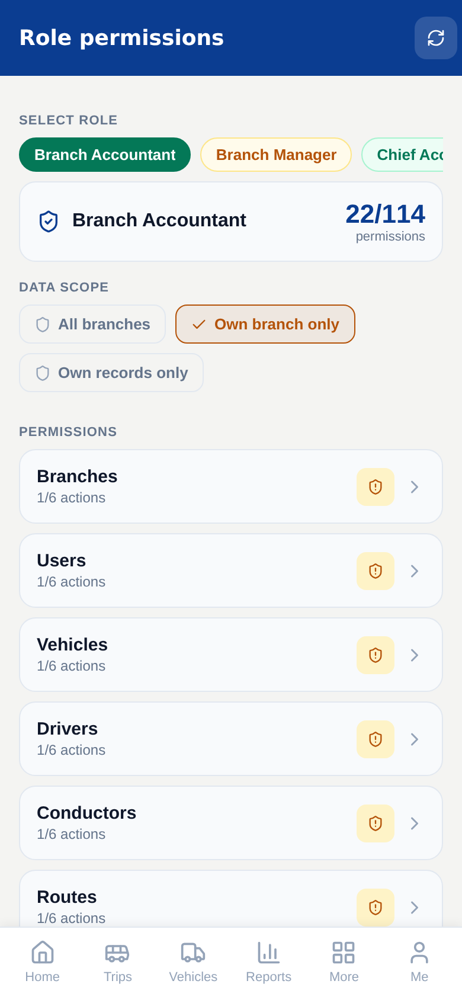

*Role permissions*

#### User accounts

Create a user with **Invite user**, then assign a role. You can only grant roles at or below your own seniority — a branch manager cannot create an owner. Assign a branch to make the account branch-scoped.

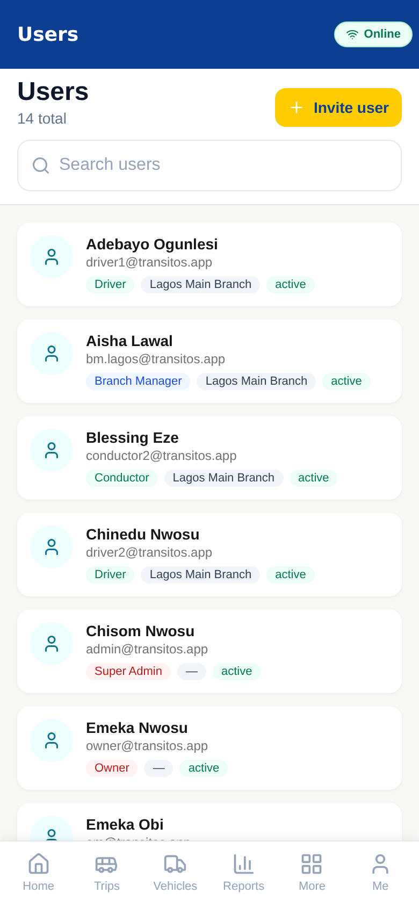

*User accounts*

#### A user record

Open a user to see their details, their role, the branch they belong to and their status. Change the role here, or suspend the account without deleting its history.

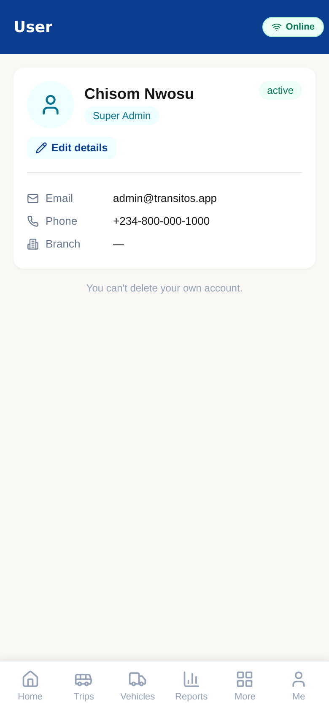

*A user record*

#### Branches

A branch is a depot. Create the branch first, because vehicles, staff, trips and money all belong to one. On a branch record you can also assign or clear the branch manager.

*Branches*

#### A branch record

Open a branch to see its address, contact details and GPS position, and to assign or clear the branch manager. Use **Clear manager** to hand a branch back to the pool without deleting it.

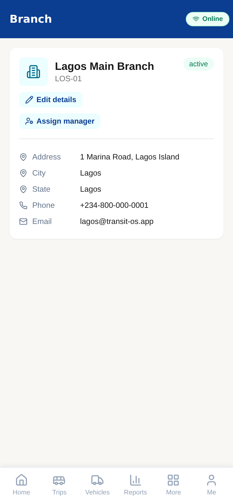

*A branch record*

#### Vehicles

The vehicle list shows every vehicle across the company with its status, odometer and fuel level.

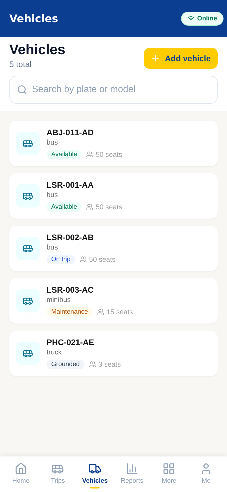

*Vehicles*

#### A vehicle record

A vehicle record carries its registration, capacity, current odometer and fuel, and every document attached to it. Documents that are about to expire are called out so you can renew them before they lapse.

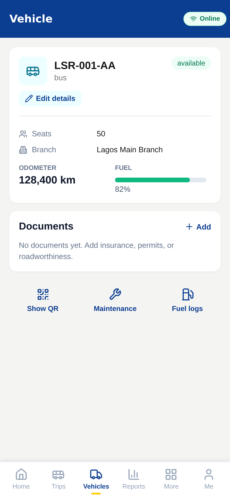

*A vehicle record*

#### Drivers

Driver records carry the licence number and expiry date. The app warns you before a licence lapses, which is why the expiry date matters.

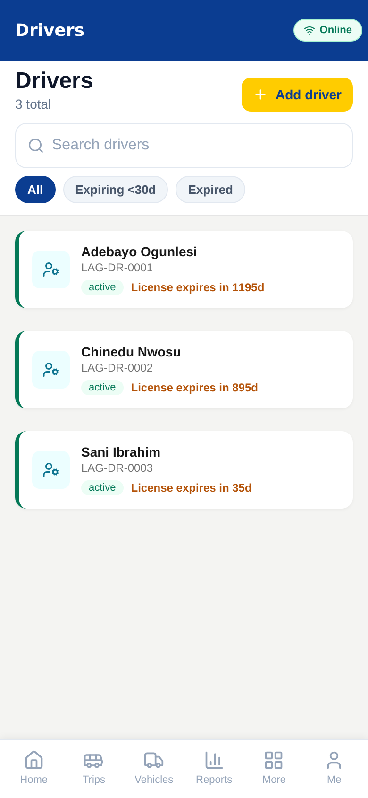

*Drivers*

#### A driver record

Open a driver to see their full record, licence and years of experience.

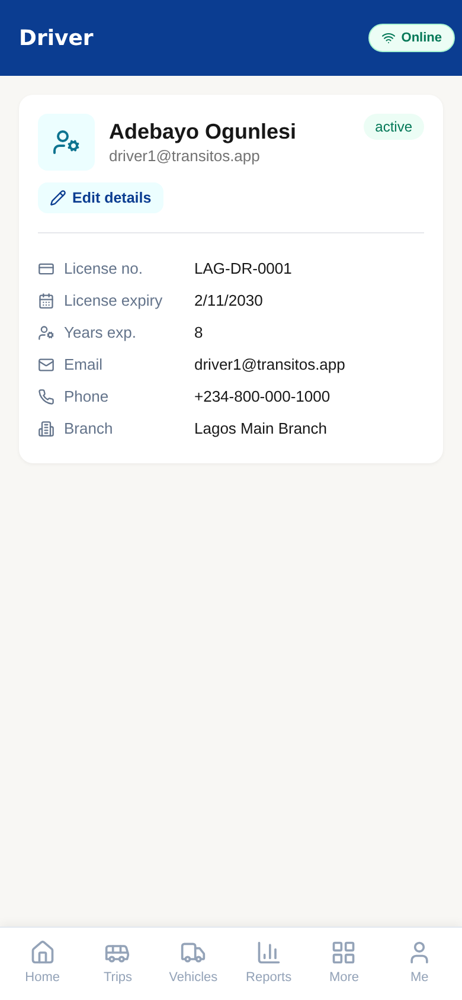

*A driver record*

#### Conductors

Conductor records carry the badge number and employment status.

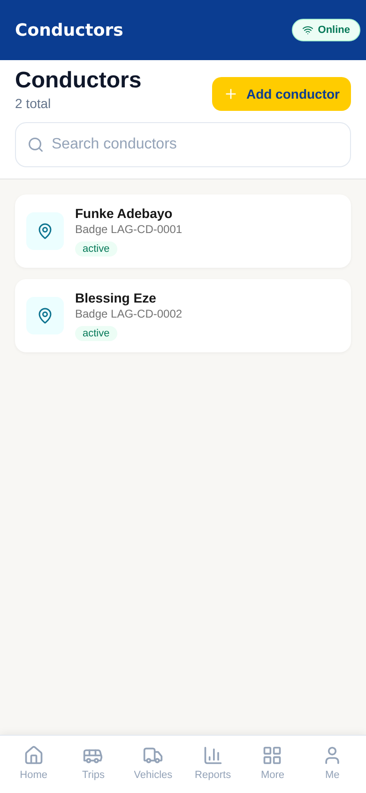

*Conductors*

#### A conductor record

Open a conductor to see the badge number and status.

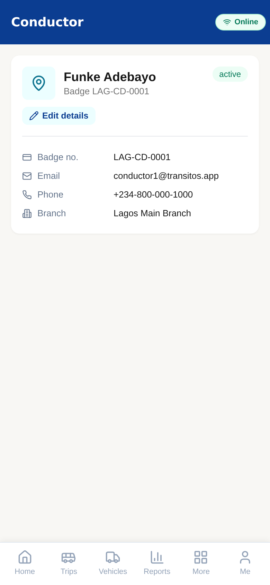

*A conductor record*

#### Routes

Routes describe a journey: origin and destination, distance, base fares and estimated duration.

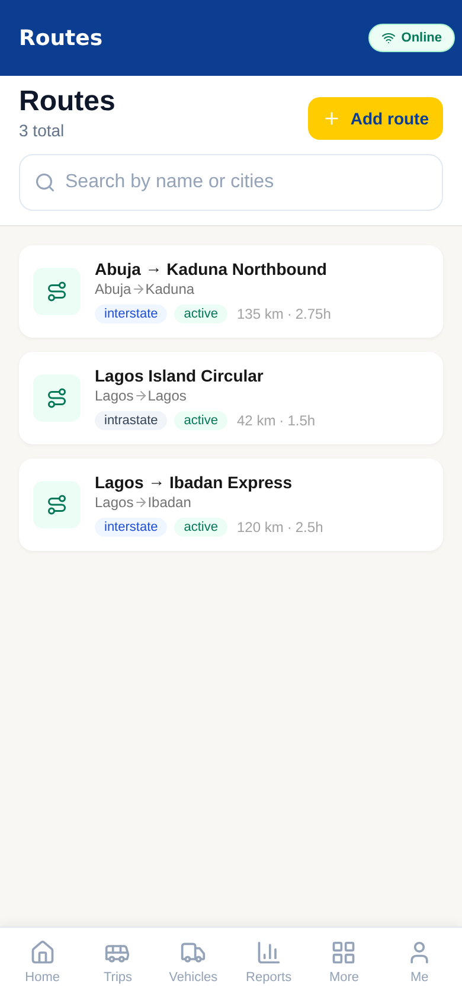

*Routes*

#### A route record

Open a route to see the full journey definition, including the base passenger fare, the cargo rate per kilogram and any permits the route requires.

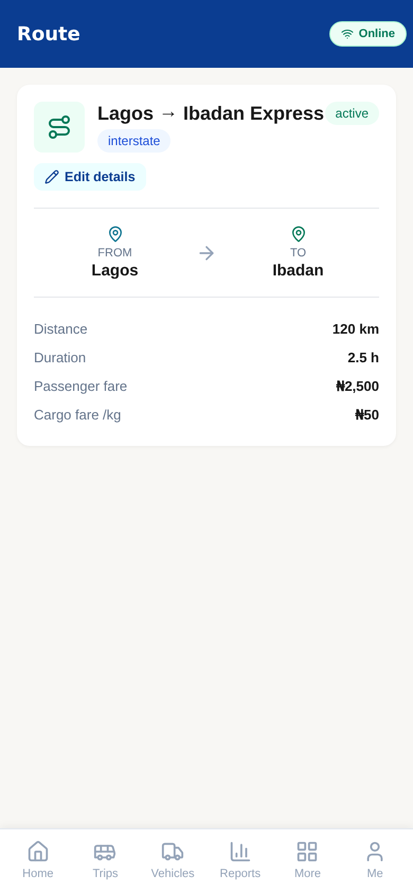

*A route record*

#### Trips

The trips list is the day's work. Filter by status, branch or vehicle; open a trip to see the vehicle, the crew and the money.

*Trips*

#### A trip

A trip screen shows the schedule, the assigned vehicle and crew, passenger numbers and the revenue and expenses accrued against it.

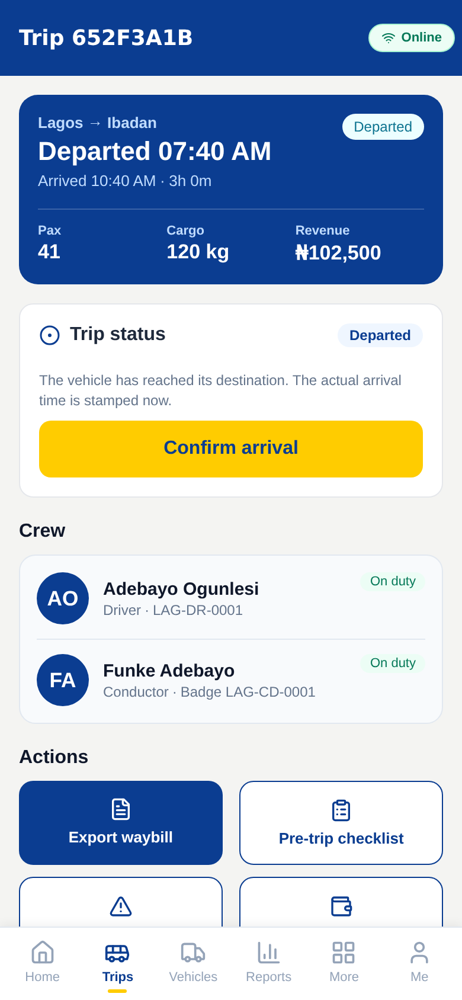

*A trip*

#### Trip status

The **Trip status** card at the top of the trip carries the stage the trip is at and the button that moves it on: **Start boarding**, **Confirm departure**, **Confirm arrival**, **Close trip**. **Cancel trip** calls the journey off and asks for a reason, which is kept on the trip and in the audit log. The server enforces the order — a trip cannot skip a stage, and a closed trip cannot be reopened. Branch managers, operations managers and above can move a trip; everyone else sees the card read-only.

#### The manifest

The **Manifest** section lists the passengers and cargo booked onto the trip, and the fare each one contributes. **+ Passenger** and **+ Cargo** add an entry, and the bin icon removes one. The list locks once the trip departs — a passenger cannot board a vehicle that has already left. This list is what the app uses to work out what the trip *should* have collected, so it is the basis of every variance figure in the app.

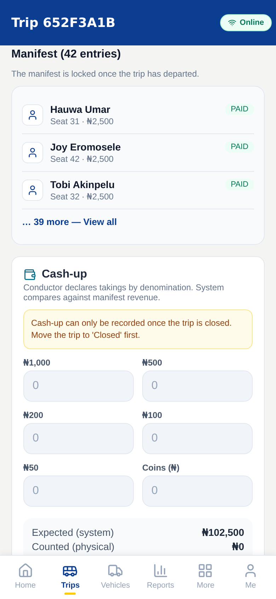

*The manifest*

#### The cash-up on a trip

The **Cash-up** card at the bottom of the trip is where the conductor declares the day's takings. The denominations are entered as counts of notes and coins, and the card shows the expected figure (from the manifest), the counted figure and the variance between them. **Save cash-up** records the declaration as a draft that only the conductor can see; **Submit for approval** sends it to finance, and the server fixes the expected figure and the variance at that moment. A submitted cash-up cannot be edited; if an approver rejects it, the conductor sees the reason, corrects the count and submits again.

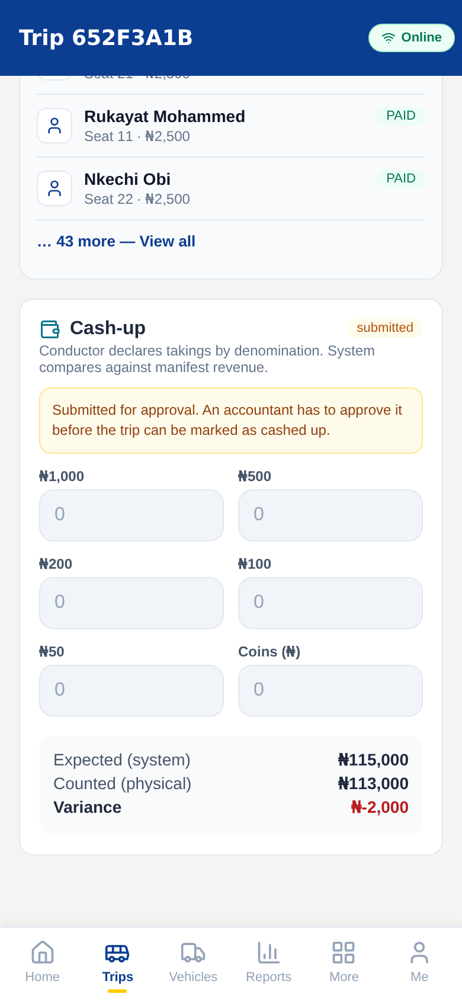

*The cash-up on a trip*

#### Declaring a cash-up

A cash-up that has been saved but not yet sent to finance is a **draft**. It shows a *draft* badge, and only the person who saved it can see or change it. Enter the counts of notes and coins, then **Save cash-up** to keep it as a draft, or **Submit for approval** to send it to finance — the server fixes the expected figure and the variance at that moment.

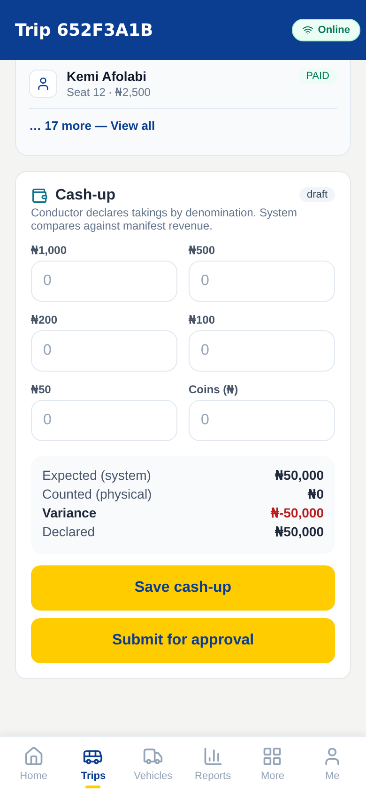

*Declaring a cash-up*

#### A completed trip

Once a trip has closed, it shows its final passenger count, revenue and expenses — the figures that feed the reports and the settlements.

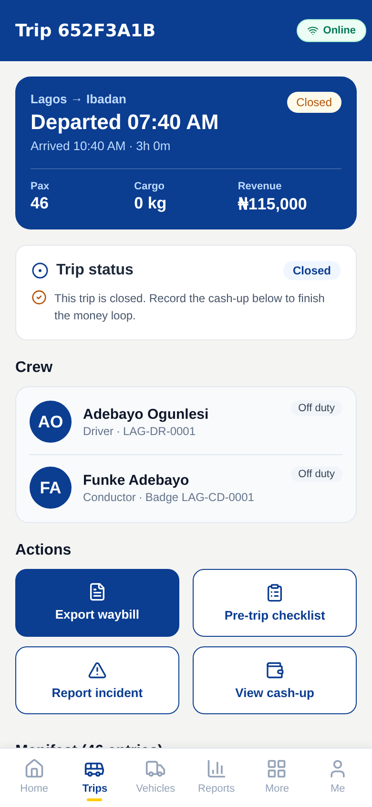

*A completed trip*

#### The live trip board

The live board updates itself over a live connection as trips move between planned, boarding, departed and arrived. A green badge means the live connection is up.

*The live trip board*

#### Incidents

The counters along the top show how many incidents are severe, moderate, minor and closed. Open an incident to acknowledge it — which tells the reporter someone has seen it — or to resolve it with a note explaining what was done.

*Incidents*

#### An incident

The incident screen carries the full report, photos, who was notified, and the acknowledge and resolve actions.

*An incident*

#### Reporting an incident

The category list comes from the server, so it always matches what the system accepts: mechanical, accident, theft, passenger dispute, cargo damage, weather or other.

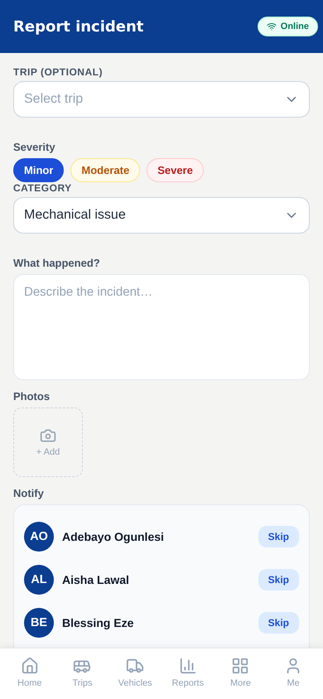

*Reporting an incident*

#### Fuel

Every fuel purchase: litres, total cost, price per litre and the odometer at the time.

*Fuel*

#### Maintenance

Scheduled, in-progress and completed maintenance, with parts, labour and the next due distance.

*Maintenance*

#### Expenses

Expenses are either on-trip costs — fuel, tolls, permits, meals tied to a specific journey — or standalone branch overheads. Both reach the profit-and-loss report, but only the trip-linked ones are traceable to a journey.

*Expenses*

#### Cash-ups

The cash-up list is the reconciliation queue: what each conductor declared against what the trip expected, and who has approved it. Filter it by *Awaiting approval*, *Approved*, *Rejected* or *Draft*. A draft can be sent for approval from the list itself; a submitted one opens the review sheet, where **Approve** and **Reject** (with a reason) sit. Approving a cash-up marks its trip as *cashed up*.

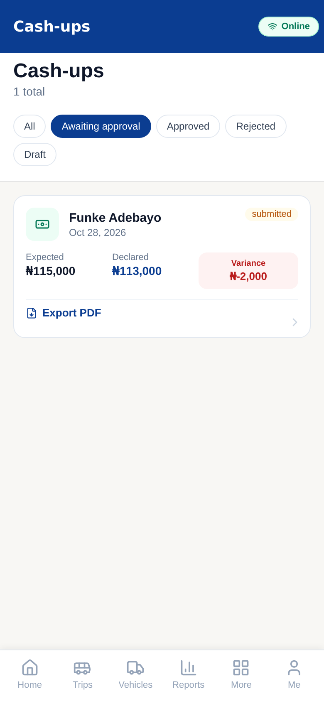

*Cash-ups*

#### Settlements

A settlement is a branch's payroll for a period. Each one holds one line per completed trip, with the gross revenue, the trip expenses and what each crew member is owed.

*Settlements*

#### A settlement

The settlement detail shows the headline figures and the per-trip lines behind them. Every figure on the summary can be traced to a line, and an approved or paid settlement is locked.

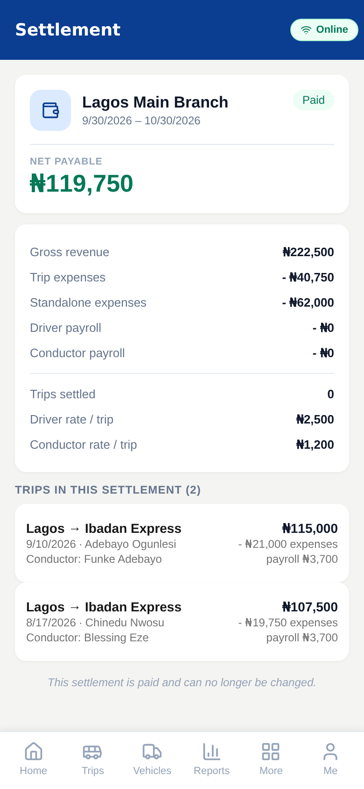

*A settlement*

#### Reports

Financial and operational reporting over 7, 30 or 90 days, with PDF export.

*Reports*

#### Vehicle transfers

Moving a vehicle between branches, through initiated, confirmed, returned or cancelled.

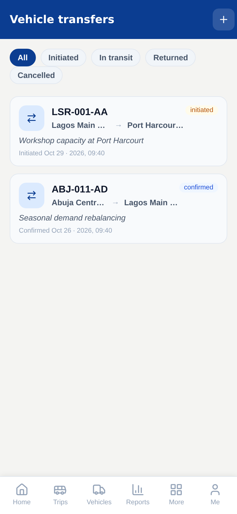

*Vehicle transfers*

#### The live fleet map

Every vehicle's live position, with counts by status along the top.

*The live fleet map*

> **Boundary.** Nothing is hidden from you, but every action you take is written to the audit log with your name, your role, the time and your IP address.

---

### 2.2 Company Owner

*Role code: `owner`*

**Who this role is for.** The principal of the transport company. You are interested in the numbers: revenue, cost, utilisation and what each branch is contributing.

**What you are responsible for**

- The company-wide dashboard and financial reports
- Settlement approvals and the settlement history
- Every branch's performance side by side

**What you can reach**

Tab bar: Home, Trips, Vehicles, More, Reports, Profile.

Screens: `/branches`, `/users`, `/vehicles`, `/drivers`, `/conductors`, `/routes`, `/trips`, `/fuel`, `/maintenance`, `/expenses`, `/cash-ups`, `/reports`, `/audit-log`, `/role-permissions`, `/map`, `/transfers`, `/incidents`, `/pre-trip-checklist`, `/settlements`, `/devices`, `/trips/live`, `/scan`.

#### Your dashboard

The dashboard opens on the company's headline figures: revenue, active buses, cash variance and open incidents.

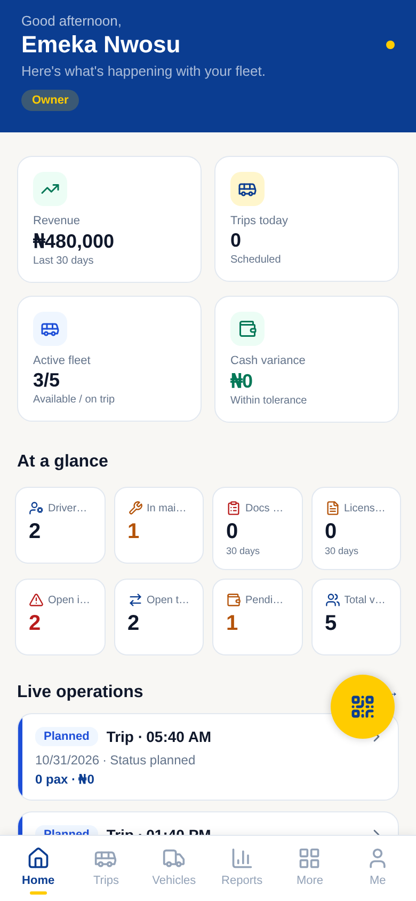

*Your dashboard*

#### Reading the reports

The reports screen is your view of the business. Switch between 7, 30 and 90 days to see the trend, then export the PDF for the board pack.

*Reading the reports*

#### Settlements

A settlement is what a branch owes its crew for a period. Read the summary to see the gross revenue, the costs deducted and the net payable, then open one to check the per-trip lines behind the headline figures.

*Settlements*

#### The More menu

Everything that does not need its own tab lives in the More menu, grouped by area.

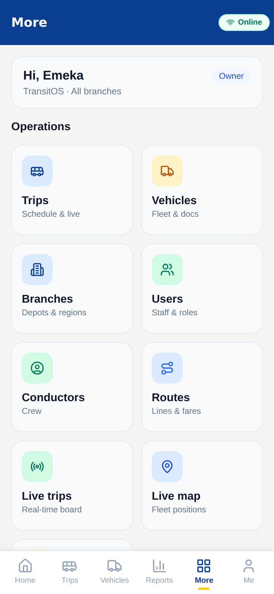

*The More menu*

> **Boundary.** You do not normally edit operational records day to day — you review them and direct the managers who do.

---

### 2.3 General Manager

*Role code: `general_manager`*

**Who this role is for.** The person running operations across the whole company. You turn the owner's direction into trips, vehicles, routes and staff.

**What you are responsible for**

- The company-wide operations dashboard
- Creating and scheduling trips across all branches
- Branches, routes, vehicles, drivers and conductors
- Incident acknowledgement and resolution
- The live trip board for every bus in the fleet

**What you can reach**

Tab bar: Home, Trips, Vehicles, More, Reports, Profile.

Screens: `/branches`, `/users`, `/vehicles`, `/drivers`, `/conductors`, `/routes`, `/trips`, `/fuel`, `/maintenance`, `/expenses`, `/cash-ups`, `/reports`, `/audit-log`, `/role-permissions`, `/map`, `/transfers`, `/incidents`, `/pre-trip-checklist`, `/settlements`, `/devices`, `/trips/live`, `/scan`.

#### Your dashboard

The dashboard greets you with your role and shows the company's operations at a glance. Pull down to refresh it at any time.

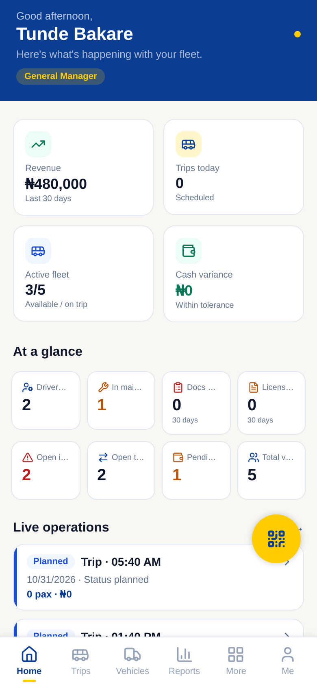

*Your dashboard*

#### Scheduling trips

Tap **New trip**, choose the route, vehicle, driver and conductor, and set the departure and arrival times. The trip appears in the list as **planned** and becomes **boarding**, then **departed**, as the crew update it from the road.

*Scheduling trips*

#### A trip

Open a trip to see the schedule, the vehicle, the named crew and the money that has accrued against it.

*A trip*

#### The manifest

The **Manifest** section lists the passengers and cargo booked onto the trip, and the fare each one contributes. **+ Passenger** and **+ Cargo** add an entry, and the bin icon removes one. The list locks once the trip departs — a passenger cannot board a vehicle that has already left. This list is what the app uses to work out what the trip *should* have collected, so it is the basis of every variance figure in the app.

*The manifest*

#### The cash-up on a trip

The **Cash-up** card at the bottom of the trip carries the day's declaration: the expected figure from the manifest, what the conductor counted, and the variance between them. Once a cash-up has been submitted the server owns those figures and the card is locked for reading; only a rejection sends it back to the conductor to correct.

*The cash-up on a trip*

#### The live trip board

The live board is the shortest path to knowing where the fleet is. Each card is one trip, and cards move between states as the crew update the trip. A green **Live** badge means the connection is up; if it turns amber the app falls back to periodic refresh.

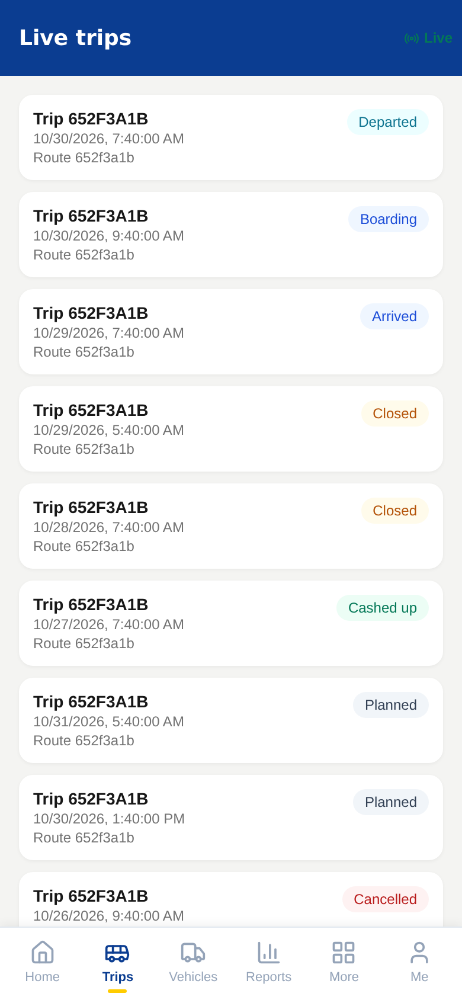

*The live trip board*

#### The fleet

Every vehicle with its status, odometer and fuel level. A vehicle that is not **available** cannot be scheduled onto a new trip.

*The fleet*

#### Branches

Your branches, with their addresses and assigned managers.

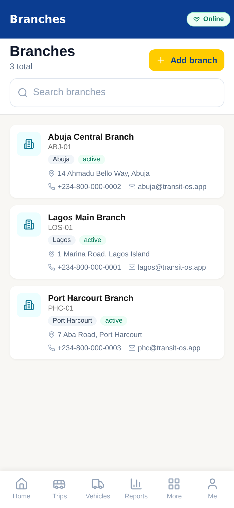

*Branches*

#### People

The people across the company and the roles they hold.

*People*

#### Incidents

Severity counters across the top, a filter row beneath, and the list of incidents beneath that.

*Incidents*

#### An incident

Acknowledge it to confirm you have seen it, or resolve it with a note explaining what was done. Both actions are recorded.

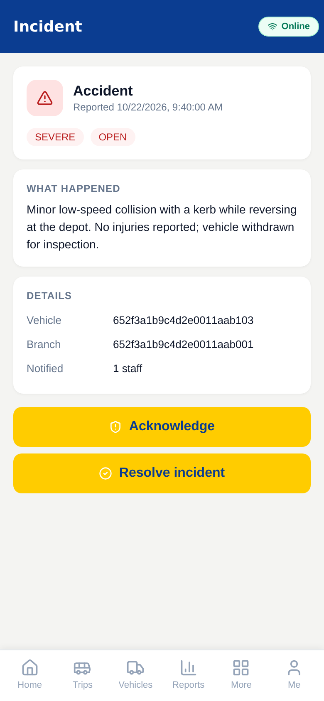

*An incident*

#### Reporting an incident

Choose a category from the list the server provides, set the severity honestly, describe what happened and attach photos if you have them.

*Reporting an incident*

#### The fleet map

The map shows every vehicle's live position, with counts by status along the top. Use it to answer *where is the bus?* before anyone calls you.

*The fleet map*

#### Reports

Financial and operational reporting over 7, 30 or 90 days, with PDF export.

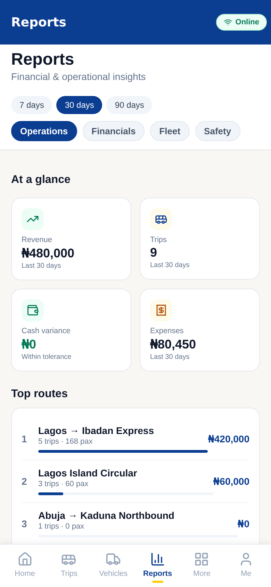

*Reports*

#### Settlements

See what each branch owes its crew for the period, and open a settlement to check the per-trip lines behind the headline figures.

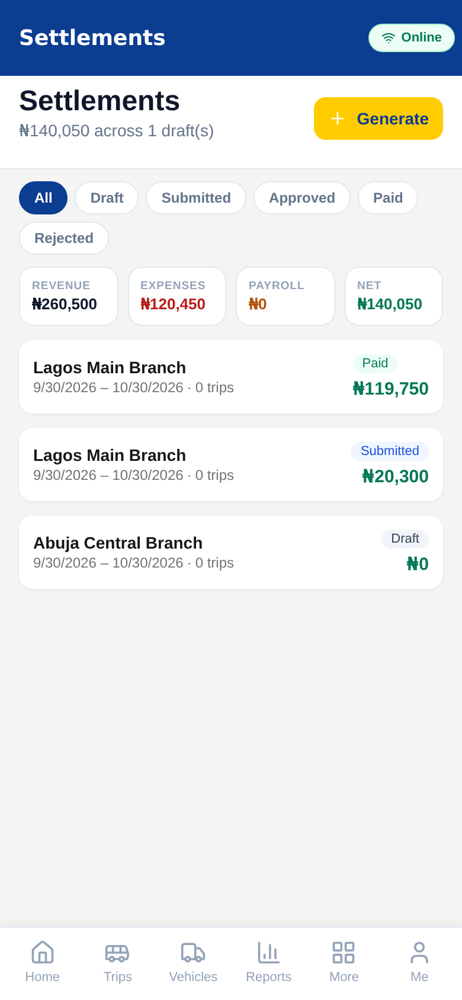

*Settlements*

#### The More menu

Your operations, finance, fleet and system tools, in one place.

*The More menu*

#### Your profile

Your details, your password, and the device you are signed in on.

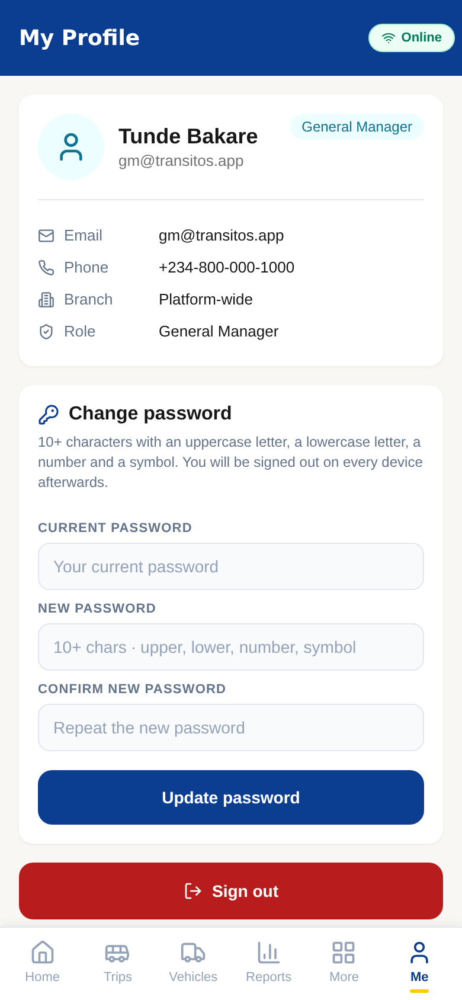

*Your profile*

> **Boundary.** You cannot change the role-permission matrix — that is reserved for the platform administrator.

---

### 2.4 Branch Manager

*Role code: `branch_manager`*

**Who this role is for.** The person in charge of one branch. You run the day-to-day at your own depot and see only your branch's data.

**What you are responsible for**

- Your branch's trips, vehicles, staff and cash-ups
- Your branch's users and their roles
- The branch record itself and its assigned manager
- Your branch's settlements

**What you can reach**

Tab bar: Home, Trips, Vehicles, More, Reports, Profile.

Screens: `/branches`, `/users`, `/vehicles`, `/drivers`, `/conductors`, `/routes`, `/trips`, `/fuel`, `/maintenance`, `/expenses`, `/cash-ups`, `/reports`, `/map`, `/transfers`, `/incidents`, `/pre-trip-checklist`, `/settlements`, `/devices`, `/trips/live`, `/scan`.

#### Your dashboard

Your dashboard covers your branch only. The greeting and the figures beneath it are your branch's.

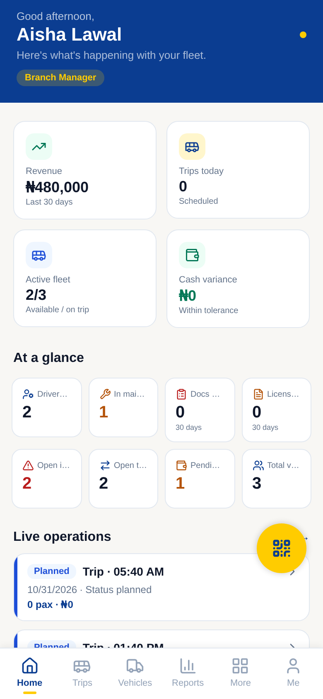

*Your dashboard*

#### Your branch's trips

Every trip that belongs to your branch, and nothing from another branch. The restriction is enforced by the server, not just hidden in the app.

*Your branch's trips*

#### Moving a trip along

Open a trip and use the **Trip status** card at the top: **Start boarding**, **Confirm departure**, **Confirm arrival**, **Close trip**, and **Cancel trip** with a reason. You can also correct the manifest of a trip that has not departed yet, and declare or submit a cash-up once the trip is closed.

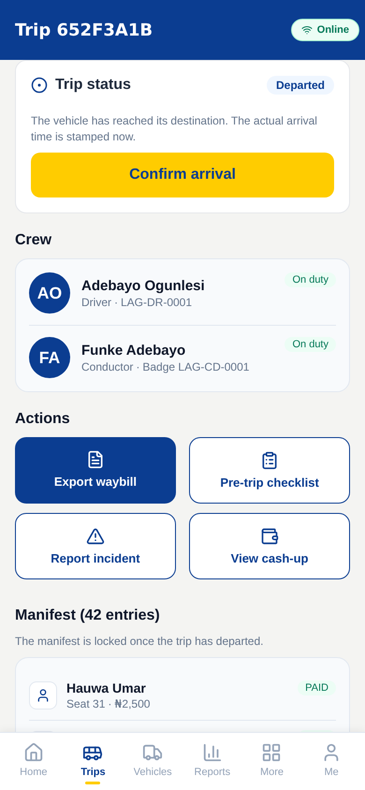

*Moving a trip along*

#### Declaring a cash-up

Once the trip is closed, the **Cash-up** card at the bottom of the screen is where the day's takings are declared. Enter the counts of notes and coins, check the variance against the expected figure, then **Save cash-up** and **Submit for approval**.

*Declaring a cash-up*

#### Your branch

You see only your own branch. Open a branch record to update its details, or to assign or clear the branch manager.

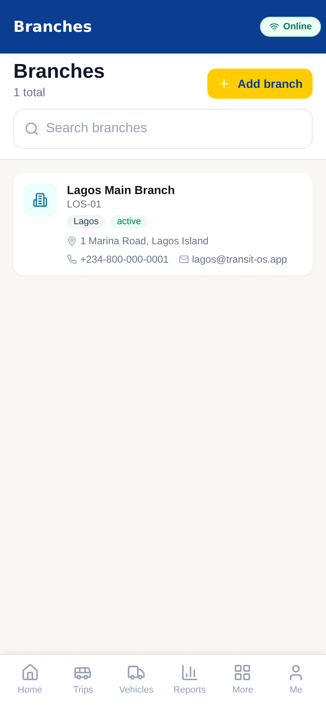

*Your branch*

#### Your branch record

Open the branch to see its address, contact details and assigned manager, and to assign or clear the branch manager.

*Your branch record*

#### Your branch's people

Create accounts for your branch's staff and assign the roles you are entitled to — branch accountant, driver and conductor.

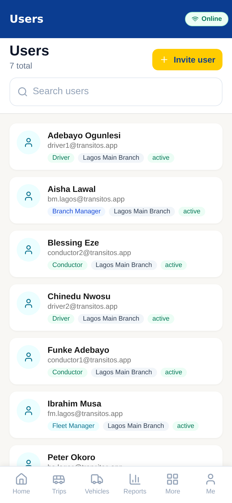

*Your branch's people*

#### Your branch's settlements

What your branch owes its crew for the period. Approval itself sits with the chief accountant.

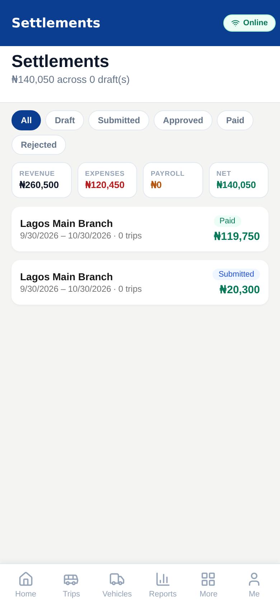

*Your branch's settlements*

#### The More menu

Your branch's tools, grouped by area.

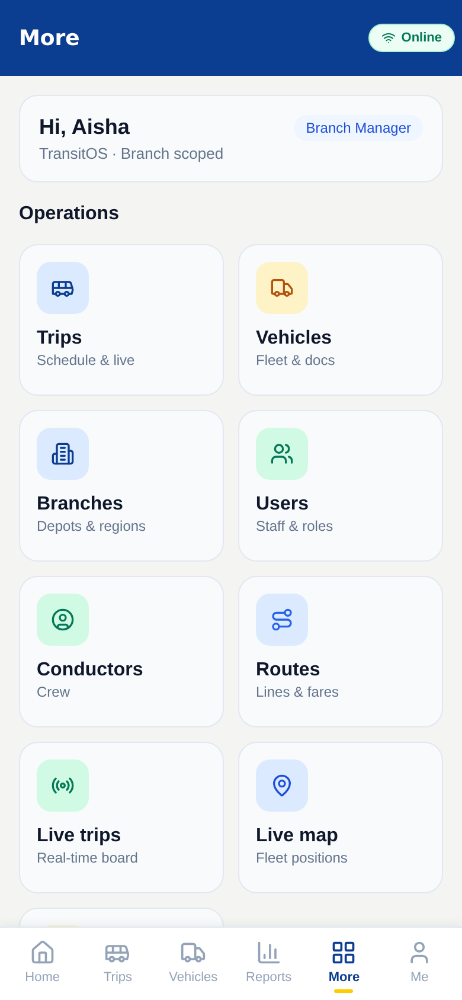

*The More menu*

> **Boundary.** You cannot see or edit records belonging to another branch — the restriction is enforced by the server, not just hidden in the app.

---

### 2.5 Operations Manager

*Role code: `operations_manager`*

**Who this role is for.** The person coordinating the day's transport: where the buses are, which trips are running, and what went wrong.

**What you are responsible for**

- The live fleet map and the live trip board
- Trip scheduling and status changes
- Reporting incidents and tracking them to resolution

**What you can reach**

Tab bar: Home, Trips, Vehicles, More, Reports, Profile.

Screens: `/branches`, `/vehicles`, `/drivers`, `/conductors`, `/routes`, `/trips`, `/reports`, `/map`, `/transfers`, `/incidents`, `/pre-trip-checklist`, `/devices`, `/trips/live`, `/scan`.

#### Your dashboard

The day's operational picture: trips, buses, cash variance and open incidents.

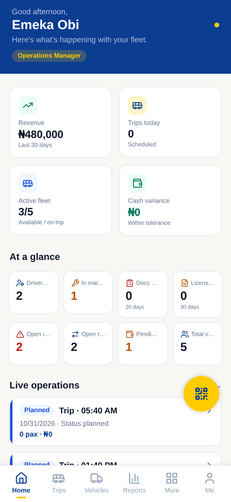

*Your dashboard*

#### Trips

Schedule and manage the day's work across the company.

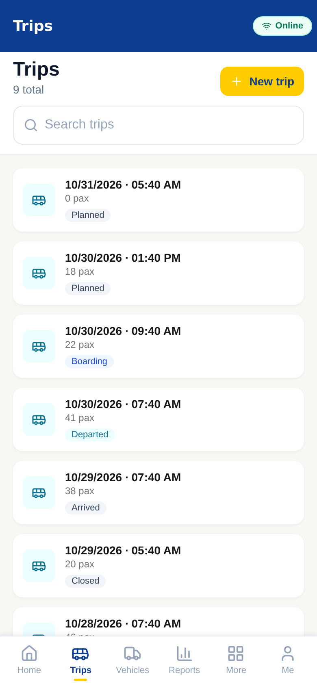

*Trips*

#### The live trip board

Live trip states, updating as the crews report them.

*The live trip board*

#### Incidents

Everything reported on the road, with severity counters to triage it.

*Incidents*

#### The fleet map

Every vehicle's live position, with counts by status. This is the screen you will use most often.

*The fleet map*

#### The More menu

Your operational tools, grouped by area.

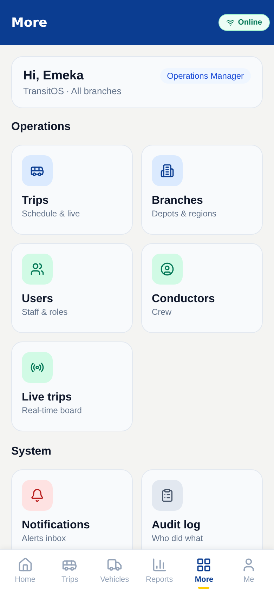

*The More menu*

> **Boundary.** Financial screens are outside your role — settlements and expenses are not part of your view.

---

### 2.6 Fleet Manager

*Role code: `fleet_manager`*

**Who this role is for.** The person responsible for the vehicles: their condition, their fuel, their maintenance and their paperwork.

**What you are responsible for**

- Vehicle records and their documents
- Fuel logs and maintenance records
- Incident reports for fleet vehicles
- The fleet map

**What you can reach**

Tab bar: Home, Trips, Vehicles, More, Reports, Profile.

Screens: `/vehicles`, `/drivers`, `/conductors`, `/routes`, `/trips`, `/fuel`, `/maintenance`, `/reports`, `/map`, `/transfers`, `/incidents`, `/pre-trip-checklist`, `/devices`, `/trips/live`, `/scan`.

#### Your dashboard

The state of the fleet at a glance.

*Your dashboard*

#### The fleet

The vehicle list is sorted by what needs attention: status, odometer and fuel level for every vehicle in your scope. A vehicle in **maintenance** or **grounded** is not available for scheduling.

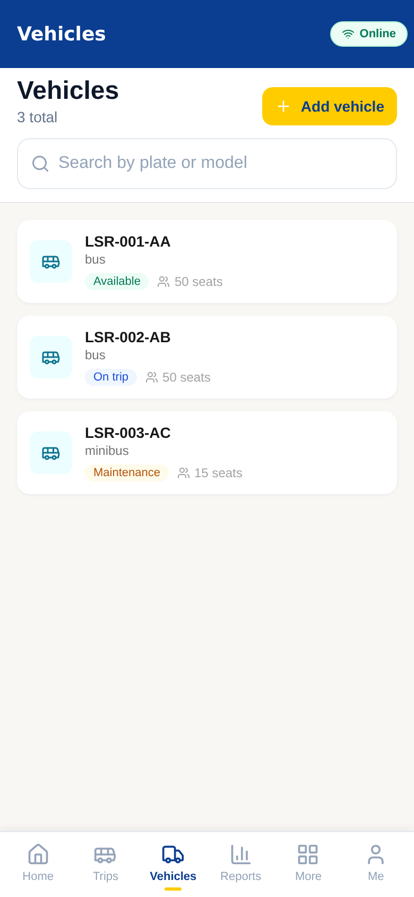

*The fleet*

#### A vehicle record

The vehicle's registration, capacity, odometer, fuel and documents. Everything the vehicle needs is on this one screen.

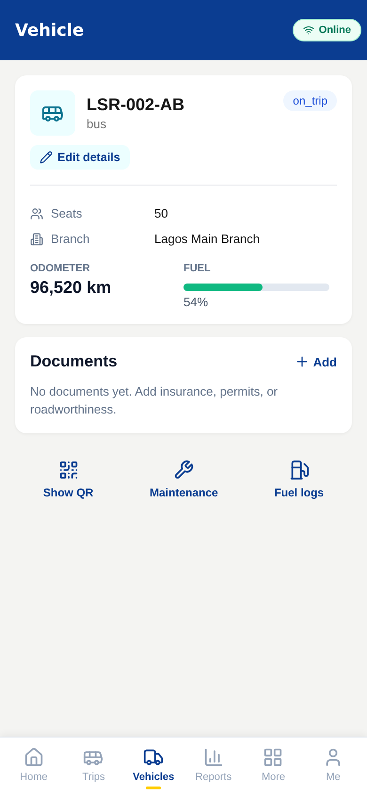

*A vehicle record*

#### Fuel logs

Log every fill-up: litres, the total paid, the odometer and the station. The cost per litre is calculated for you, so a pricing dispute can be checked against the receipt.

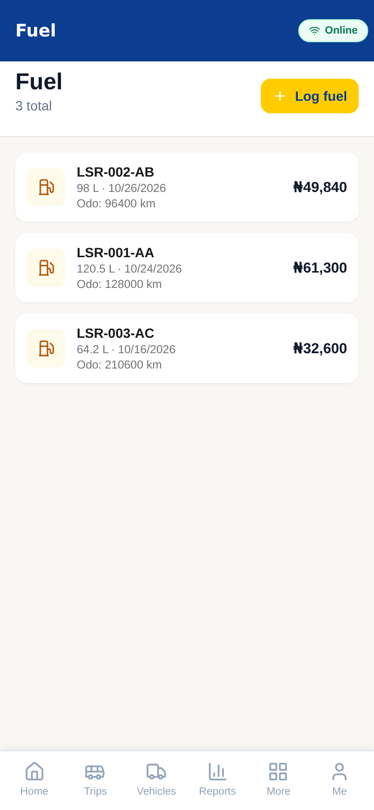

*Fuel logs*

#### Maintenance

Schedule maintenance with a due date or a due distance. The app raises a notification when servicing falls due, and keeps the next due distance on the record so the reminder comes automatically.

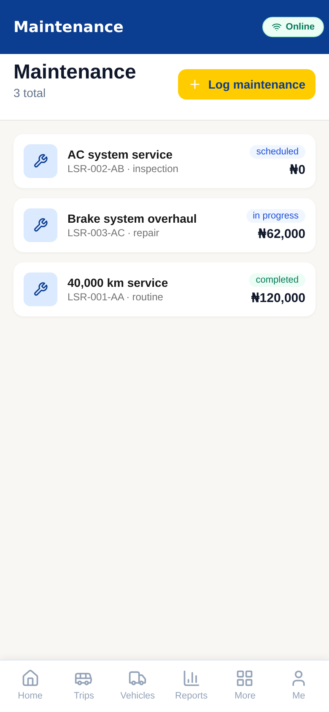

*Maintenance*

#### Incidents

Mechanical and accident reports for your vehicles.

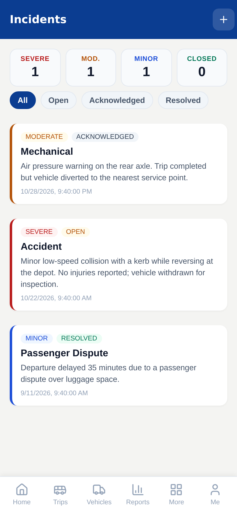

*Incidents*

#### The fleet map

Where every vehicle is, and how many are available, on trip, in maintenance or grounded.

*The fleet map*

#### The More menu

Your fleet tools, grouped by area.

*The More menu*

> **Boundary.** You do not handle money — expenses, cash-ups and settlements belong to the finance roles.

---

### 2.7 Chief Accountant

*Role code: `chief_accountant`*

**Who this role is for.** The person responsible for the company's money: what came in, what went out, and what is owed to the crew.

**What you are responsible for**

- Expenses across the whole company
- Settlement generation, approval and payment
- Financial and operational reports
- Reconciliation of cash-ups against trip revenue

**What you can reach**

Tab bar: Home, More, Reports, Profile.

Screens: `/expenses`, `/cash-ups`, `/reports`, `/settlements`, `/devices`.

#### Your dashboard

The company's financial position at a glance.

*Your dashboard*

#### Expenses

Expenses are either **on-trip** costs — fuel, tolls, permits, meals charged to a specific journey — or **standalone** branch overheads. Both reach the profit-and-loss report, but only the trip-linked ones are traceable to a journey.

*Expenses*

#### Settlements

Generate a settlement for a branch and period, and TransitOS builds one line per completed trip with the gross revenue, the trip expenses and the net. Set the driver and conductor pay rates, then submit it for approval. A settlement that has been approved or paid is locked and cannot be edited.

*Settlements*

#### A settlement

The headline figures and the per-trip lines behind them. Every figure on the summary can be traced to a line, so a question about a number always has an answer.

*A settlement*

#### Reports and export

Reports show revenue, cost and operational performance over 7, 30 or 90 days. Export the PDF for the month-end pack.

*Reports and export*

#### The More menu

Your finance tools, grouped by area.

*The More menu*

> **Boundary.** You do not schedule trips or edit vehicles — that is the operations and fleet side.

---

### 2.8 Branch Accountant

*Role code: `branch_accountant`*

**Who this role is for.** The person doing the books for one branch. You see your branch's costs and cash, not other branches'.

**What you are responsible for**

- Your branch's expenses and cash-ups
- Your branch's settlements
- Branch-scoped reports

**What you can reach**

Tab bar: Home, Trips, More, Reports, Profile.

Screens: `/users`, `/trips`, `/expenses`, `/cash-ups`, `/reports`, `/settlements`, `/devices`.

#### Your dashboard

Your branch's financial position. You see your branch's data only.

*Your dashboard*

#### Your branch's expenses

You see only your own branch's costs. Record each expense against the vehicle it belongs to and, where it is trip-linked, the journey it was incurred on.

*Your branch's expenses*

#### Cash-ups

Cash-ups show what each conductor declared against what the trip expected. Check the variance before you approve anything. Tap a cash-up marked *Awaiting approval* to open the review sheet: it shows the declared amount, the expected amount, the variance and the breakdown by payment method. **Approve** accepts it — the trip is then marked as *cashed up* — and **Reject** sends it back with a reason the conductor can act on.

*Cash-ups*

#### Branch-scoped reports

The same reporting as the chief accountant, limited to your branch.

*Branch-scoped reports*

#### The More menu

Your branch's finance tools, grouped by area.

*The More menu*

> **Boundary.** You cannot see another branch's figures, and you cannot approve a settlement — approval sits with the chief accountant.

---

### 2.9 Driver

*Role code: `driver`*

**Who this role is for.** The person behind the wheel. Your job in the app is to confirm the vehicle is roadworthy and to report problems the moment they happen.

**What you are responsible for**

- The pre-trip checklist for your assigned vehicle
- Reporting incidents from the road
- Your own trips and their live status

**What you can reach**

Tab bar: Home, Trips, More, Profile.

Screens: `/trips`, `/pre-trip-checklist`, `/devices`, `/trips/live`, `/scan`.

#### Your dashboard

Your dashboard shows the work that is yours: your trips and the state they are in.

*Your dashboard*

#### Your trips

The trips assigned to you, with their current status.

*Your trips*

#### Your trip

The schedule, the route, the vehicle and the passenger numbers recorded so far.

*Your trip*

#### The trip status

The **Trip status** card at the top of the trip shows which stage the trip is at. A driver can read it but not move the trip — the button is for a branch manager, an operations manager or the head office.

*The trip status*

#### The live trip board

Your live board shows the trips assigned to you and their current state, updating as the day progresses.

*The live trip board*

#### The pre-trip checklist

Run the checklist before every trip. Work down the template, marking each item pass or fail. A failed item is not a problem to hide — it is the whole point of the checklist. Add a note, report it as an incident if it affects safety, and tell your manager before the vehicle moves.

*The pre-trip checklist*

#### Reporting a problem

If something goes wrong on the road, report it while it is fresh. Choose the category that fits, set the severity honestly, describe what happened and attach a photo if it helps.

*Reporting a problem*

#### The More menu

The tools available to you, grouped by area.

*The More menu*

#### Your profile

Your details, your password, and the device you are signed in on.

*Your profile*

> **Boundary.** You see your own trips and your own vehicle — not the fleet, the finances or other people's records.

---

### 2.10 Conductor

*Role code: `conductor`*

**Who this role is for.** The person who sells the tickets, counts the money and hands the cash in at the end of the trip.

**What you are responsible for**

- Declaring the trip's cash-up and submitting it for approval
- Your own trips and their live status
- Reporting incidents on board

**What you can reach**

Tab bar: Home, Trips, More, Profile.

Screens: `/trips`, `/cash-ups`, `/devices`, `/trips/live`, `/scan`.

#### Your dashboard

Your dashboard shows the trips you are working and their state.

*Your dashboard*

#### Your trips

The trips assigned to you, with their current status.

*Your trips*

#### Your trip

The trip screen shows the route, the schedule, the vehicle and the passenger numbers recorded so far.

*Your trip*

#### Recording your manifest

As passengers board, add each one to the **Manifest** on the trip screen: **+ Passenger** for a fare, **+ Cargo** for a parcel. This list is what the app uses to work out what the trip should have collected, so it is what you are measured against. The list locks when the trip departs. If you record someone who did not travel, remove the entry with the bin icon before the trip closes.

*Recording your manifest*

#### Declaring your cash-up

At the end of a trip, declare what you collected. Enter the counts of notes and coins in the **Cash-up** card, and the app shows the expected figure from your manifest, what you have counted, and the variance between them.

*Declaring your cash-up*

#### The cash-ups list

Your cash-ups, and the ones waiting for approval. A draft of yours can be sent for approval from here as well as from the trip screen. The breakdown by payment method is shown for each cash-up, together with what the trip expected and the variance. Your manager reviews it; a variance is raised with you, not against you.

Press **Save cash-up** to record your count as a draft — only you can see it, and you can save it again to correct the count. Press **Submit for approval** when the count is final; the app then fixes the expected figure and the variance and sends it to finance. You cannot edit a submitted cash-up. If an approver sends it back, the reason appears on your trip screen — correct the count, save and submit again.

*The cash-ups list*

#### The More menu

The tools available to you, grouped by area.

*The More menu*

#### Your profile

Your details, your password, and the device you are signed in on.

*Your profile*

> **Boundary.** You cannot approve your own cash-up — a manager reviews it.

---

## Part 3 — Reference

### 3.1 Status colours

TransitOS uses the same colours everywhere, so a colour always means the same thing.

| Colour | Meaning | Where you see it |
|---|---|---|
| Green | Good, active, complete, available | Vehicle available, trip departed, cash-up approved |
| Blue | In progress, planned, informational | Trip planned or boarding, informational notices |
| Amber | Needs attention but not yet urgent | Service due, low fuel, trip delayed |
| Red | Serious, blocked or refused | Severe incident, overdue, rejected |
| Grey | Inactive, closed or no longer current | Closed trip, retired vehicle, rejected cash-up |
| Navy | TransitOS brand colour, primary actions | Header, primary buttons |
| Yellow | Accent, the primary action on a screen | Sign In button, status underline |

**Trip statuses.** `planned`, `boarding`, `departed`, `arrived`, `closed`, `cashed_up`, `cancelled`.

**Vehicle statuses.** `available`, `on_trip`, `maintenance`, `grounded`.

**Cash-up statuses.** `draft`, `submitted`, `approved`, `rejected`.

**Settlement statuses.** `draft`, `submitted`, `approved`, `paid`, `rejected`.

---

### 3.2 Roles and access at a glance

This is the authoritative view of who can open what. It is generated directly from the application configuration, so it always matches the running app.

| Screen | Roles that can open it |
|---|---|
| `/branches` | Super Admin, Owner, General Manager, Branch Manager, Operations Manager |
| `/users` | Super Admin, Owner, General Manager, Branch Manager, Branch Accountant |
| `/vehicles` | Super Admin, Owner, General Manager, Branch Manager, Operations Manager, Fleet Manager |
| `/drivers` | Super Admin, Owner, General Manager, Branch Manager, Operations Manager, Fleet Manager |
| `/conductors` | Super Admin, Owner, General Manager, Branch Manager, Operations Manager, Fleet Manager |
| `/routes` | Super Admin, Owner, General Manager, Branch Manager, Operations Manager, Fleet Manager |
| `/trips` | Super Admin, Owner, General Manager, Branch Manager, Operations Manager, Fleet Manager, Branch Accountant, Driver, Conductor |
| `/fuel` | Super Admin, Owner, General Manager, Branch Manager, Fleet Manager |
| `/maintenance` | Super Admin, Owner, General Manager, Branch Manager, Fleet Manager |
| `/expenses` | Super Admin, Owner, General Manager, Branch Manager, Chief Accountant, Branch Accountant |
| `/cash-ups` | Super Admin, Owner, General Manager, Branch Manager, Chief Accountant, Branch Accountant, Conductor |
| `/reports` | Super Admin, Owner, General Manager, Branch Manager, Operations Manager, Fleet Manager, Chief Accountant, Branch Accountant |
| `/audit-log` | Super Admin, Owner, General Manager |
| `/role-permissions` | Super Admin, Owner, General Manager |
| `/map` | Super Admin, Owner, General Manager, Operations Manager, Branch Manager, Fleet Manager |
| `/transfers` | Super Admin, Owner, General Manager, Operations Manager, Branch Manager, Fleet Manager |
| `/incidents` | Super Admin, Owner, General Manager, Operations Manager, Branch Manager, Fleet Manager |
| `/pre-trip-checklist` | Super Admin, Owner, General Manager, Operations Manager, Branch Manager, Fleet Manager, Driver |
| `/settlements` | Super Admin, Owner, General Manager, Chief Accountant, Branch Accountant, Branch Manager |
| `/devices` | Super Admin, Owner, General Manager, Branch Manager, Operations Manager, Fleet Manager, Chief Accountant, Branch Accountant, Driver, Conductor |
| `/trips/live` | Super Admin, Owner, General Manager, Branch Manager, Operations Manager, Fleet Manager, Driver, Conductor |
| `/scan` | Super Admin, Owner, General Manager, Branch Manager, Operations Manager, Fleet Manager, Driver, Conductor |

---

### 3.3 Glossary

| Term | Meaning |
|---|---|
| **Branch** | A depot. Vehicles, staff, trips and money belong to a branch. |
| **Cash-up** | A conductor's declaration of the money collected on a trip, compared against what the trip expected. |
| **Cash variance** | The difference between the cash declared and the cash expected. Negative means a shortage. |
| **Draft** | A cash-up that has been saved but not sent for approval yet. Only the conductor who saved it can see it, and only they can change it. |
| **Category** | The type of an expense — fuel, toll, maintenance, permit, meal, accommodation or other. |
| **Expense** | A cost. On-trip if it belongs to a journey, standalone if it is branch overhead. |
| **Expected total** | What the app calculates the trip should have collected — the sum of the fares on its manifest. It is the figure a cash-up is measured against. |
| **Fuel log** | A record of one fill-up: litres, cost, price per litre and odometer. |
| **Incident** | A report of something that happened on the road — mechanical, accident, theft, passenger dispute, cargo damage, weather or other. |
| **Live board** | The screen that updates trip states automatically over a live connection. |
| **Maintenance** | Work on a vehicle, scheduled or in progress, with parts and labour cost and the next due distance. |
| **Manifest** | The passenger or cargo list for a trip. It is what the expected total is calculated from, and it locks when the trip departs. |
| **On-trip expense** | A cost incurred on a specific journey. |
| **Pre-trip checklist** | The standard inspection a crew walks through before a vehicle carries passengers. |
| **Role** | What a person is permitted to see and do. Ten roles exist, from Super Admin down to Driver and Conductor. |
| **Scope** | The records you can reach. Branch-scoped roles see only their own branch. |
| **Settlement** | A branch's payroll for a period, built from one line per completed trip. |
| **Standalone expense** | A branch overhead not tied to a journey. |
| **Trip** | One scheduled journey of one vehicle with a named driver and conductor. |
| **Vehicle transfer** | Moving a vehicle from one branch to another. |

---

### 3.4 Troubleshooting

| What you see | What it means | What to do |
|---|---|---|
| "Network Error" when signing in | The app cannot reach the server. | Check your connection and try again. If you are on office Wi-Fi, try your phone's data. |
| "Offline" badge in the header | The app has lost the connection to the server. | Keep working — the app retries. Do not close it if you are mid-entry; your draft is kept. |
| A screen says *not found* | The record was deleted, or it belongs to a branch outside your scope. | Go back to the list and refresh. If you should have access, ask your administrator to check your branch assignment. |
| A list is empty | Either there is nothing recorded yet, or everything is filtered out. | Clear the filters first. If it is genuinely empty, the yellow button on that screen creates the first record. |
| You cannot see a screen in the More menu | Your role does not include it. | See Part 3.2 for who can open what, and ask your administrator if you believe the access is wrong. |
| A settlement will not edit | Approved and paid settlements are locked. | That is deliberate. Ask the chief accountant if a correction is needed. |
| "Trip must be 'closed' before cash-up" | The trip has not been closed yet. | Open the trip and use the **Trip status** card to move it on to **Close trip**. A cash-up can only be raised on a closed trip. |
| "Cannot add manifest to a trip in status 'departed'" | The manifest locks once the trip has left. | That is deliberate — a passenger cannot board a vehicle that has already gone. Fill the manifest before the trip departs. |
| The expected figure is zero | The manifest is empty, so the app has nothing to compare the cash against. | Add the passengers and cargo to the trip's manifest while it is still planned or boarding. |
| "A cash-up already exists for this trip" | The trip already has a cash-up — a second one cannot be created. | Open the trip and **Save cash-up** to correct the one that is there, rather than creating another. |
| A cash-up will not submit | It has already been submitted, or it has been approved. | Only a draft can be submitted. A submitted cash-up is waiting for an accountant; a rejected one is back with the conductor to correct. |
| A password change is refused | The new password does not meet the policy. | Use at least 8 characters with an upper-case letter, a lower-case letter, a digit and a special character. |
| Push notifications stopped arriving | The device may have been unregistered, or it may no longer be registered at all. | Open **My devices** under Profile and register the phone again. |

---

### 3.5 Version

| | |
|---|---|
| Application | TransitOS 1.1.0 |
| Manual | User Manual 1.1 |
| Roles | 10 |

